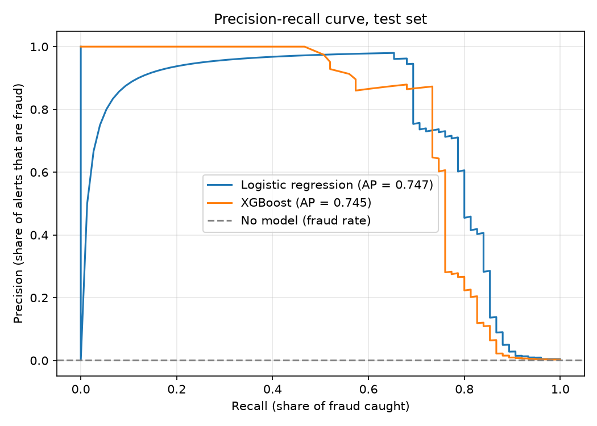
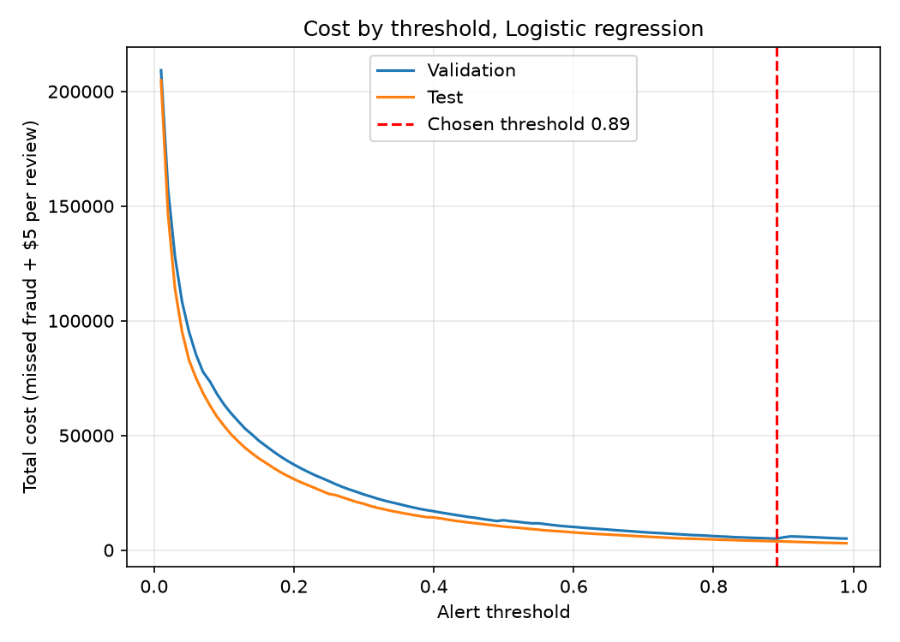
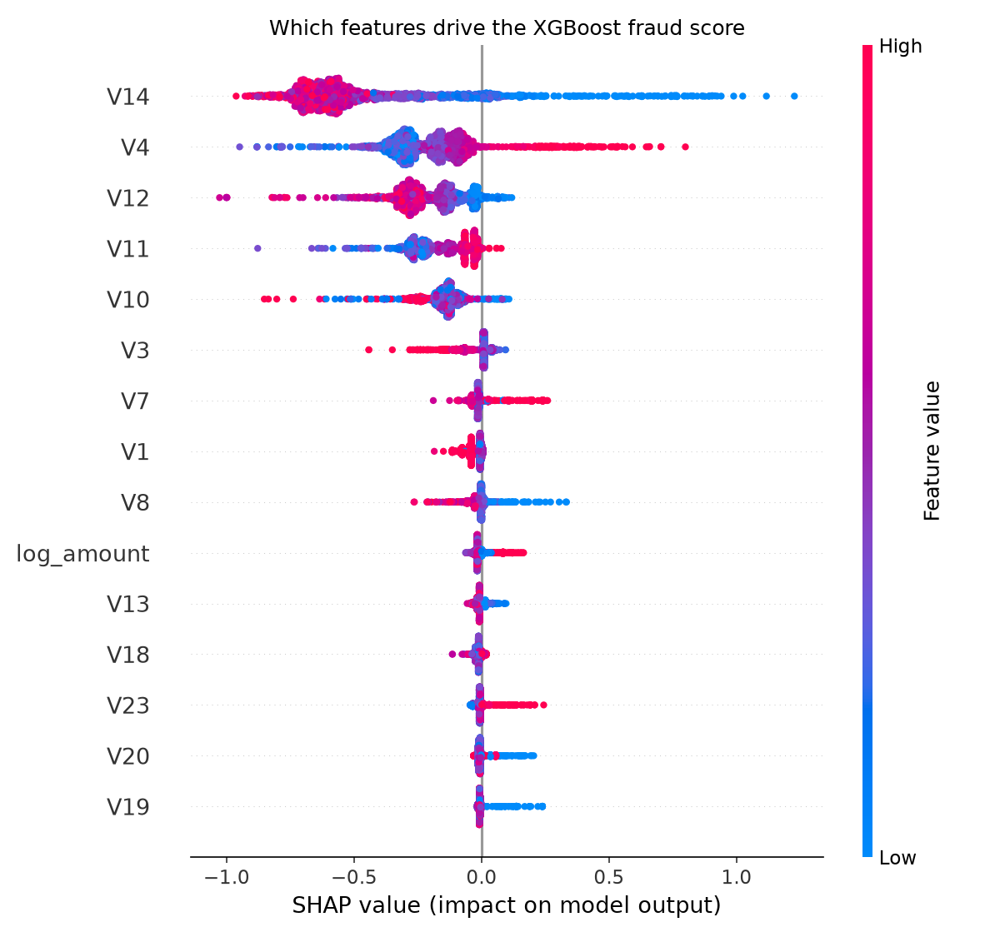

# Credit Card Fraud Detection

Fraud model for 284,807 European card transactions (0.17% fraud), evaluated on a time-ordered test set and tuned by business cost instead of accuracy.

**Result:** Logistic regression reached an average precision (PR-AUC) of 0.747 on the test set. With a cost-based alert threshold of 0.89, simulated total cost fell by 50.0% compared with having no model.



## Why this project

I spent 6.5 years in payment fraud at Amazon, writing rules and investigating card fraud. This project applies the same thinking to a machine learning model: fraud is rare, a missed fraud costs more than a false alert, and accuracy is a misleading metric.

## Data

- Source: [Kaggle, Credit Card Fraud Detection](https://www.kaggle.com/datasets/mlg-ulb/creditcardfraud) (Worldline and ULB Machine Learning Group).
- 284,807 transactions over two days in September 2013, 492 frauds.
- Columns: `Time`, `Amount`, `Class`, and `V1` to `V28`, which are anonymised PCA components. They cannot be interpreted by name.

## Method

1. **SQL analysis** in SQLite: fraud rate by hour and amount band, largest frauds, cumulative loss (`sql/fraud_analysis.sql`).
2. **Time-ordered split:** first 60% of transactions train, next 20% validation, last 20% test. No shuffling, because fraud patterns change over time.
3. **Models:** logistic regression with class weights, and XGBoost with `scale_pos_weight` and early stopping on the validation set.
4. **Metrics:** average precision, plus precision and recall when analysts review the top 1% of scores. ROC-AUC is reported but not used to choose a model, because it looks good even for weak models on rare-event data.
5. **Cost-based threshold:** a missed fraud costs its transaction amount, and every flagged transaction costs $5 of analyst time (an assumption). The threshold is chosen on validation data only, then measured once on the test set.
6. **Explainability:** SHAP summary for the XGBoost model.

## Results (test set)

| Model | Average precision | ROC-AUC | Recall at top 1% | Cost reduction vs no model |
|---|---|---|---|---|
| Logistic regression | 0.747 | 0.982 | 86.7% | 50.0% |
| XGBoost | 0.745 | 0.968 | 84.0% | 44.3% |

Logistic regression was selected because it had the higher average precision on the validation set (0.756 vs 0.716). On the test set the two models rank fraud almost equally well, and the simpler model is also cheaper at its chosen threshold.





## Power BI dashboard

Three pages: overview, model performance with a threshold selector, and an investigation queue. The input files are in `dashboard/data/` (`scored_transactions.csv` is regenerated by `src/train.py`). Dashboard file and screenshots coming soon.

## Limitations

- The data is from 2013 and covers only two days, so it cannot show how fraud patterns change over months.
- Features are anonymised, so there is no feature engineering from real attributes such as merchant, device or customer history.
- The $5 review cost is an assumption. The best threshold changes with the real cost.
- With production data I would add velocity features (transactions per card per hour), device and address signals, and a monitoring plan for drift.

## Project structure

```
├── data/                 # creditcard.csv goes here (not committed)
├── sql/                  # fraud analysis queries
├── src/                  # load_to_sqlite.py, run_queries.py, train.py
├── notebooks/            # 01_eda.ipynb
├── reports/figures/      # PR curve, cost curve, SHAP summary
└── dashboard/data/       # CSVs for the Power BI dashboard
```

## Reproduce

```
python3.13 -m venv .venv
source .venv/bin/activate
pip install -r requirements.txt
python src/load_to_sqlite.py
python src/run_queries.py
python src/train.py
```

Download `creditcard.csv` into `data/` first (see `data/README.md`).
